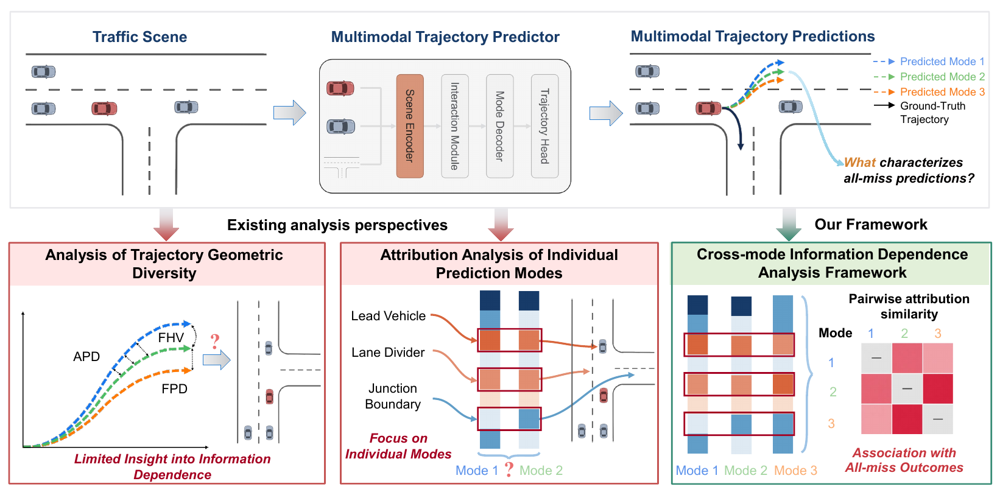
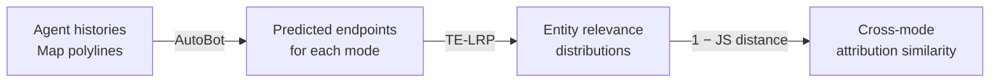
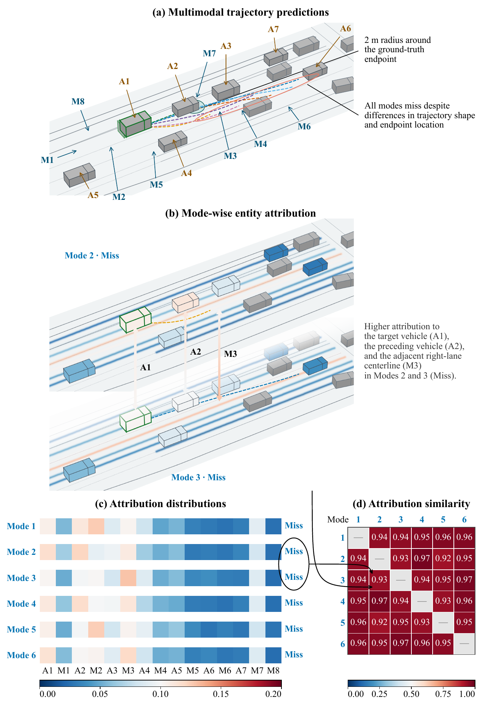

<h1 align="center">TE-LRP</h1>

<p align="center">
  <strong>Trajectory Endpoint Layer-wise Relevance Propagation for AutoBot</strong>
</p>

<p align="center">
  <a href="environment.yml"></a>
  <a href="environment.yml"></a>
  <a href="LICENSE"></a>
</p>

<p align="center">
  <a href="#overview">Overview</a> ·
  <a href="#all-miss-example">All-miss example</a> ·
  <a href="#quick-start">Quick start</a> ·
  <a href="#usage-guides">Usage guides</a> ·
  <a href="#development">Development</a> ·
  <a href="#acknowledgments-and-licensing">License</a>
</p>

---

TE-LRP attributes AutoBot's predicted endpoints to **agents and map entities** and compares these attributions across prediction modes.

This repository provides AutoBot training, prediction, and TE-LRP for **AV2, Waymo Open Motion, and nuScenes** in ScenarioNet PKL format.

**Paper:** Characterizing All-Miss Outcomes in Multimodal Trajectory Prediction through Cross-Mode Attribution<br>
Liguo Zhang, Lei Lian, Yasushi Yamaguchi, Rui Shi.

<!-- Source: supplied main.pdf, PDF page 3, Fig. 1; 300 dpi crop (108, 122, 502, 317) pt, measured from the top-left. -->
<p align="center">
  <a href="assets/figures/paper_fig1_overview.png">
    
  </a>
</p>

Geometrically distinct trajectories can still miss together. Comparing their attributions helps characterize shared dependence on agents and road elements.

## Overview



| Capability | What you get |
|---|---|
| **Endpoint attribution** | Separate signed relevance for each mode's predicted x and y endpoint coordinates. |
| **Entity relevance** | Agent and map attribution vectors, magnitudes, normalized distributions, and validity flags. |
| **Cross-mode comparison** | Pairwise attribution similarities and a mean over distinct mode pairs. |

Similarity is one minus the base-2 Jensen–Shannon (JS) distance between entity relevance distributions. Attribution uses predicted coordinates without ground truth, FDE, or hit/miss labels. See the [method and output reference](docs/attribution.md) for propagation rules and validity handling.

### All-miss example

In this example from the paper, all six predicted endpoints fall outside the 2 m hit region despite differences in trajectory shape and endpoint location.

<!-- Source: supplied main.pdf, PDF page 23, complete Fig. 5; 300 dpi crop (150, 122, 460, 575) pt. -->
<p align="center">
  <a href="assets/figures/paper_fig5_all_miss.png">
    
  </a>
</p>

Modes 2 and 3 both emphasize the target vehicle (A1), preceding vehicle (A2), and adjacent right-lane centerline (M3). The distributions and similarity matrix show shared attribution patterns across all six modes. A-labels denote vehicles and M-labels denote map entities. Colors in (b) and (c) indicate attribution weights; gray diagonal cells in (d) omit self-similarities.

## Quick start

### Installation

```bash
git clone https://github.com/ryanwilson202605/TE-LRP.git
cd TE-LRP
conda env create -f environment.yml
conda activate te-lrp
```

The tested runtime uses Python 3.9, PyTorch 2.8.0, and NumPy 2.0.2. [environment.yml](environment.yml) lists the dependencies and pins the ScenarioNet source commit. Run the commands below directly from the repository root. For GPU execution, use a PyTorch CUDA wheel compatible with your machine; for CPU execution, add `device=cpu` to the attribution command.

### Prepare data

Prepare your own ScenarioNet PKL database containing `dataset_summary.pkl`, `dataset_mapping.pkl`, and all referenced scene files; input data is not bundled with this repository. To convert official AV2, Waymo, or nuScenes data, follow the [data preparation guide](docs/data-preparation.md).

### Run endpoint attribution

```bash
python -m te_lrp.attribution \
  'val_data_path=[./data/merged_val]' \
  max_data_num=1 \
  attribution.batch_limit=1
```

Place your validation database at `./data/merged_val`, or replace that path with its actual location. The command uses the included [AutoBot checkpoint](checkpoints/autobot.ckpt) and defaults to CUDA. `max_data_num=1` limits preprocessing to one source scene per data directory; `attribution.batch_limit=1` limits attribution to one batch. Remove both overrides to process the full dataset.

**Files written:** preprocessing caches under `outputs/cache/`, a resolved configuration, and per-target results under `outputs/attributions/`. Rerunning with the same output path overwrites the corresponding result.

### Inspect the outputs

```text
outputs/attributions/
├── config.yaml
└── <dataset>/
    └── <scenario>/
        └── <target>.npz
```

Each NPZ contains predictions, input relevance, entity distributions, cross-mode similarities, and identifiers. Read it with `numpy.load(path, allow_pickle=False)`; see [output fields and shapes](docs/attribution.md#output-fields) for the full schema.

## Usage guides

| Goal | Guide |
|---|---|
| Convert official datasets and combine PKL databases | [Data preparation](docs/data-preparation.md) |
| Train AutoBot, configure inputs, or resume a run | [Training](docs/training.md) |
| Select weights and configure attribution | [Attribution](docs/attribution.md) |
| Use the Python API and interpret saved results | [Python API](docs/attribution.md#method-and-python-api) · [Output fields](docs/attribution.md#output-fields) |
| Compare mode distributions from saved outputs | [Attribution similarity](docs/attribution.md#attribution-similarity) |
| Change paths, devices, and model settings | [Runtime configuration](te_lrp/configs/config.yaml) · [AutoBot configuration](te_lrp/configs/method/autobot.yaml) |

## Development

### Repository structure

```text
te_lrp/
├── propagation/     # TE-LRP endpoint attribution and propagation rules
│   ├── endpoint.py  # Endpoint initialization and entity aggregation
│   ├── autobot.py   # Enable propagation rules on AutoBot
│   ├── layers.py    # Layer implementations for relevance propagation
│   └── rules.py     # Basic propagation rules
├── models/          # AutoBot
├── data/            # PKL loading, preprocessing, and caching
├── configs/         # Hydra configurations
├── training/        # Training loop, validation metrics, and logging
├── similarity.py    # Pairwise attribution similarity and scene-level mean
├── train.py         # Training entry point
└── attribution.py   # Prediction and attribution entry point
checkpoints/         # Included AutoBot checkpoint
assets/figures/       # Paper figures displayed in this README
docs/                # Data preparation, training, and attribution guides
licenses/            # Original upstream license texts
tests/               # Implementation tests
```

### Testing

Install the optional test dependencies after creating the runtime environment:

```bash
python -m pip install -r requirements-dev.txt
```

```bash
python -m pytest -q tests
```

Tests cover propagation rules, IIQ, prediction equivalence, ground-truth independence, entity aggregation, attribution similarity, data caching, and checkpoint restoration.

## Acknowledgments and licensing

The original TE-LRP code and the checkpoint trained by the authors (`checkpoints/autobot.ckpt`) are released under the **GNU Affero General Public License, version 3 or any later version (AGPL-3.0-or-later)**; see [LICENSE](LICENSE). Third-party portions retain their original copyright and license notices listed below. Dataset downloads remain subject to their providers' terms.

This repository modifies the upstream AutoBot integration and preprocessing for standalone training, caching, endpoint attribution, and similarity computation. These modifications are distributed as part of TE-LRP (2026).

| Source | Use in this repository | Upstream license |
|---|---|---|
| [UniTraj](https://github.com/vita-epfl/UniTraj) | AutoBot integration, model infrastructure, and preprocessing (`te_lrp/models/`, `te_lrp/data/`) | [Upstream notice](licenses/UniTraj.txt), [AGPL v3 text](LICENSE); the notice specifies AGPLv3-or-later |
| [AutoBots](https://github.com/roggirg/AutoBots) | AutoBot model source | [BSD 3-Clause](licenses/AutoBots.txt) |
| [ScenarioNet](https://github.com/metadriverse/scenarionet), [MetaDrive](https://github.com/metadriverse/metadrive) | External data-format and loading dependencies | See the licenses distributed with each dependency |

License texts and copyright notices are retained unchanged. [LICENSE](LICENSE) contains the standard GNU AGPL v3 text; the upstream notices are preserved in [licenses/](licenses/).

UniTraj-derived portions retain the full [upstream notice](licenses/UniTraj.txt), including its additional use-related wording. The license granted for original TE-LRP contributions does not replace or remove those upstream notices.
